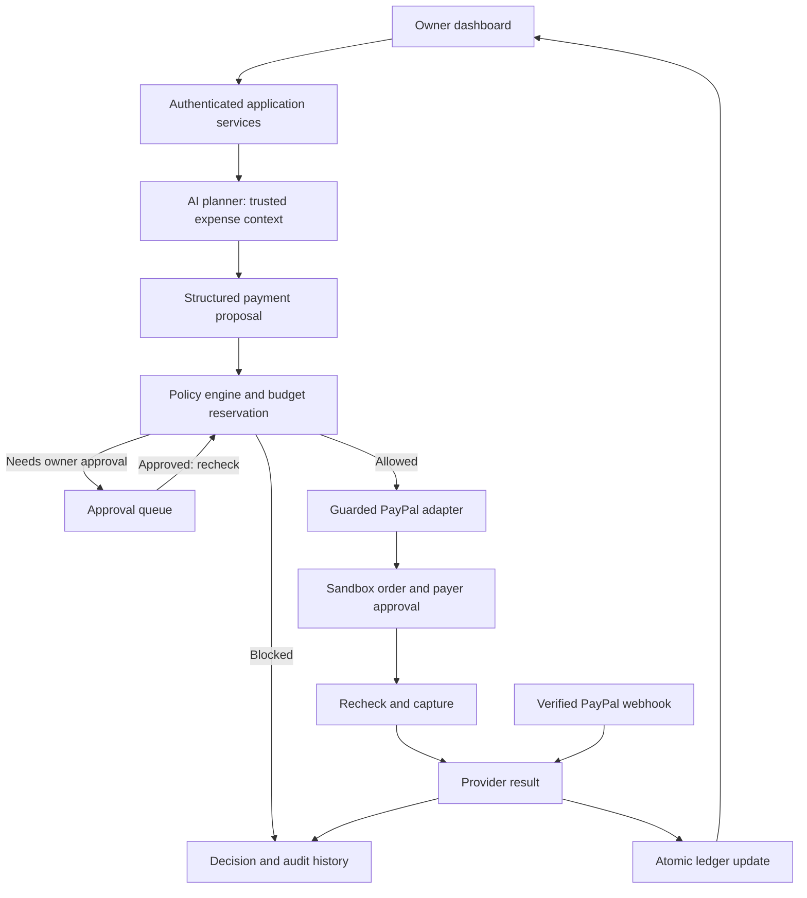

# AgentVault technical reference

Implementation notes for October 21–25, 2026. These are engineering details, not requirements for the design phase. The short schedule is in [IMPLEMENTATION_PLAN.md](IMPLEMENTATION_PLAN.md).

Design is complete when the four main screens and their simple flow are ready. Agree database/API details and check integration access when implementation begins on October 21.

All five team members work on implementation together during October 21–25. Choose task owners or pairs each day; there are no fixed specialist roles. P0 means the required demo features in the team plan.

### Core funding and task guarantees

- The owner deliberately funds the vault. The agent has no main-account credentials or authority to top it up, enable credit/overdraft, or use a fallback payment method.
- All agents, child workers, API credentials, and concurrent requests that use a vault consume the same authoritative remaining funds. Changing IP or creating another request must not create another allowance.
- A task can also restrict quantity: "generate at most 5 videos" and "spend at most $10" are separate rules. Both apply, even if videos are cheaper than expected.
- Reserve the maximum authorized cost and one task slot before launching a paid operation. Provider-enforced prepaid limits or equivalent hard authorization must cover the actual service liability, including pending work and fees.
- A service that can run unlimited work and bill later is not safe merely because its eventual payment is routed through a small vault. Such a connector must enforce a hard usage/spend boundary or remain unsupported for autonomous use.
- Every connector uses the same vault authority. IP rate limits are supplementary abuse controls, never the financial limit.

Example: at a fixed $2 per video, a task authorized for five videos and $10 may reserve at most five launches. A burst of 500 attempts cannot reserve more than five; the other attempts receive a task-limit or insufficient-funds result. This guarantee depends on every paid launch passing through the enforcement boundary.

The prototype must demonstrate four outcomes clearly: an allowed payment, a payment requiring owner approval, a blocked payment, and an agent stopped by the freeze control.

### Boundaries of this release

- An AgentVault balance is a **virtual spending allocation**, enforced within our application. It is not a deposit, separate PayPal account, or provider-enforced pool of segregated funds.
- The primary payment demonstration uses USD, a sandbox buyer, and one sandbox merchant controlled by the team. Demo expenses represent that merchant's test services, not integrations with real utility companies.
- AgentVault owner approval and PayPal payer approval are separate steps. The agent can plan and initiate checkout; the baseline demo includes the buyer approving payment in PayPal. We do not promise unattended charging.
- Recurring expenses are entered or seeded in AgentVault. Each occurrence creates a new proposal and follows the same checks. Existing consumer autopays are outside this release.
- Only the owner can allocate budget, change policy, approve exceptions, or unfreeze an agent. The AI cannot give itself those permissions.

This checkout sequence is grounded in PayPal's [Create order](https://developer.paypal.com/api/orders/v2/orders-create) and [Capture payment for order](https://developer.paypal.com/api/orders/v2/orders-capture) APIs. Account-specific behavior must be proven in the team's sandbox during the October 21 integration check.

## Architecture and stack

Recommended baseline: **Next.js + TypeScript + Tailwind, Supabase Auth/Postgres, Gemini for structured planning, and a server-side PayPal adapter.** Keep frontend and backend in one repository and one application deployment to reduce integration overhead. Use Render as the initial hosting candidate from the original proposal; The team must verify the chosen setup supports the app and a stable public HTTPS webhook during the October 21 integration check.

The PayPal adapter should use the official Agent Toolkit where the selected version supports the required operations and controls. Its documentation lists TypeScript tools and sandbox configuration. Pin and test the actual version; use direct REST inside the same guarded adapter when a tool does not expose required controls. See the [official PayPal Agent Toolkit](https://github.com/paypal/agent-toolkit).

LangGraph, a separate Python service, AG Grid, Channel3, and an external MCP service are optional later additions. The first release needs a short, explicit proposal/decision/execution workflow and a simple transaction table.

The model receives only bounded tools such as `list_due_expenses`, `propose_payment`, and `get_request_status`. Backend code invokes payment operations after authorization. The model never receives raw provider secrets, an unrestricted payment tool set, or policy-editing tools.

Keep the vault/policy service independent of PayPal-specific payloads. Each future connector must document when a paid obligation is created, its maximum cost, how authorization is consumed once, and how uncertain results are reconciled. A shared interface alone does not make an unsupported service safe. The owner-controlled funding path is separate from the agent execution path; production requires the provider's actual payment authority to respect the funded boundary as well.

### Data model and contracts

| Record | Minimum information |
| --- | --- |
| `vaults` | Owner, currency, funding/allocation records, aggregate reserved/spent totals, frozen state; explicit simulated/provider-backed mode |
| `agents` | Parent vault, owner, name, purpose, frozen state |
| `budgets` | Agent, USD allocation, reserved/spent totals, concurrency/version field |
| `task_authorizations` | Vault/agent, owner-approved purpose, maximum units and total cost, reserved/completed units, expiry |
| `policies` | Agent, version, automatic threshold, hard per-payment cap, allowed merchant IDs |
| `merchants` | Server-maintained merchant identifier, provider payee ID, allowed test services |
| `expenses` / `expense_occurrences` | Owner/agent, merchant, authoritative amount, due date, cadence, unique occurrence key |
| `payment_requests` | Agent, occurrence/obligation, immutable amount/currency/payee, state, policy version, decision reason |
| `approvals` | Request and snapshot/version, owner, decision, expiry, consumption timestamp |
| `payment_attempts` | Request, provider order/capture IDs, stable operation idempotency keys, execution state |
| `ledger_entries` | Allocation, reservation, release, and settlement records with unique operation references |
| `webhook_events` / `audit_events` | Unique provider event ID, processing status; actor, action, timestamp, redacted details |

Use integer cents for USD. `available = allocated - spent - reserved`. The team implements database constraints and atomic functions so two requests cannot reserve the same remaining budget. Check the parent vault, the agent's sub-allocation, and task cost/quantity caps together in one transaction; sub-allocations cannot create more funds than the parent has allocated. IP address is not part of the allowance identity. Application clients and agents cannot directly edit balances or ledger records. Owner checks are required in server code as well as appropriate database row-level policies.

Application contracts to agree on October 21:

- Agent and budget creation/read; owner-only policy/allocation updates and freeze/unfreeze.
- Expense creation/read and `POST /api/agents/:id/run-due`.
- `POST /api/agents/:id/plan` returns a structured proposal and decision, never a claim of payment success.
- `POST /api/requests/:id/approve` and `/reject` operate on the immutable request snapshot.
- `POST /api/requests/:id/checkout` and `/capture` accept request identity; the server resolves amounts and provider order IDs.
- `POST /api/webhooks/paypal` verifies the provider event and applies an idempotent update.
- Read-only request/activity routes plus an owner-authorized reconciliation action for uncertain payments.

All mutating routes authenticate their caller except the provider webhook, which authenticates through signature verification. Enforce ownership, request-size/rate limits, and the framework-appropriate CSRF/origin protections for browser mutations.

## Payment behavior and enforcement

1. The user selects an agent or asks it to handle a due expense. The backend supplies that agent's permitted expense context.
2. The AI selects a trusted expense/obligation and provides a concise reason. Server code resolves price, currency, merchant, owner, and agent identity; it does not trust model-supplied amounts or permissions.
3. The policy engine rejects invalid requests, frozen agents, unknown merchants, duplicate paid obligations, amounts above the hard cap, or insufficient available allocation.
4. Requests above the automatic threshold but within all hard rules enter owner approval. Approval binds to the exact request and policy version; changes or expiry invalidate it. Approval alone does not reserve funds or guarantee that funds will still be available.
5. Before checkout, revalidate rules and atomically reserve the amount. Create a PayPal order using persisted operation identifiers.
6. The sandbox buyer completes PayPal approval. A browser callback or return URL is not proof of payment.
7. Before capture, recheck the request, freeze/policy version, reservation, approval, and provider order/payee/amount. Serialize execution per request so retries cannot start concurrent captures.
8. A confirmed capture settles the reservation into spent. Verified webhooks and authenticated provider queries reconcile status through the same idempotent transition logic.
9. A timeout means the result is unknown. Keep the reservation, reconcile the existing attempt, and do not create a replacement payment blindly. Release only when the attempt is conclusively non-payable or failed and further execution has been disabled.

Suggested states: `PROPOSED`, `BLOCKED`, `AWAITING_OWNER_APPROVAL`, `REJECTED`, `RESERVED`, `AWAITING_PAYER_APPROVAL`, `CAPTURING`, `COMPLETED`, `FAILED`, `CANCELED`, and `RECONCILING`. Freeze is an agent state; it does not rewrite completed payments.

Implementation rules:

- Before launching any paid service job, atomically reserve both its maximum cost and authorized task quantity. A timeout retains both until the provider confirms the outcome; releasing a slot must not permit a second launch of an already-running job.
- Each authenticated worker is bound server-side to its vault and task. Requests from new IPs or with new request IDs still share those limits. An agent cannot create a new funded task or vault by changing request parameters.
- Budget edits cannot reduce the allocation below spent plus reserved. All owner changes are audited.
- Freeze and capture authorization share a serialized execution boundary: a freeze committed before authorization blocks that capture. Provider requests already in flight may finish; the UI explains this and keeps reconciling them.
- No installment/split-payment feature in P0. A full seeded obligation is authorized once; the agent cannot invent new IDs or split it to escape approval.
- Track each due occurrence uniquely so repeated scans do not propose or pay it twice. Pausing a local schedule stops future proposals, not completed payments or unrelated external autopays.
- Keep create-order and capture idempotency keys separate and stable across retries. Local uniqueness persists beyond provider retention; reconcile rather than blindly retry after the provider's documented window. PayPal documents this mechanism in its [idempotency guide](https://developer.paypal.com/api/rest/reference/idempotency/).
- Verify webhook signatures, deduplicate event IDs, match provider IDs/payee/amount/currency, and prevent older events from regressing settled state. Persist safely before acknowledging receipt. See PayPal's [webhook guide](https://developer.paypal.com/api/webhooks/overview/).
- Store secrets server-side, redact logs, allow only the sandbox API host in this release, and never include credentials in prompts, recordings, or the repository.

### PayPal integration checklist

| Capability | Interface | Owner / deadline |
| --- | --- | --- |
| Authenticate backend | `POST /v1/oauth2/token` | Team / Oct 21 |
| Create and inspect order | `POST /v2/checkout/orders`; `GET /v2/checkout/orders/{id}` | Team / Oct 21 proof, Oct 23 integrated |
| Capture approved order | `POST /v2/checkout/orders/{id}/capture` | Team / Oct 21 proof, Oct 23 integrated |
| Receive and verify events | Public HTTPS listener; `POST /v1/notifications/verify-webhook-signature` | Team / Oct 22 proof, Oct 23 integrated |
| Reconcile duplicate/uncertain results | Stored IDs, authenticated order lookup, idempotent transition service | Team / Oct 24 |

These endpoints are documented in PayPal's [Orders reference](https://developer.paypal.com/api/orders/v2) and [Webhooks Management reference](https://developer.paypal.com/api/webhooks/v1). Subscribe to relevant capture completion, pending, and failure events; confirm the exact event names against the tested integration. Register the webhook on the same sandbox app that creates the orders.

## Acceptance tests and October 25 release gate

| Check | Expected evidence | Owner |
| --- | --- | --- |
| Allowed payment | One real sandbox capture, matching provider IDs/amount, one ledger settlement, correct remaining budget | Team |
| Owner approval | No order/capture before required approval; reject/expired approval cannot execute | Team |
| Hard budget and merchant rules | Over-budget or unapproved-merchant proposal is blocked before provider mutation | Team |
| Concurrent spending | With $100 available and policies allowing $60, two concurrent $60 attempts cannot both reserve | Team |
| Five versus 500 jobs | In a local synthetic harness, send 500 concurrent job proposals with distinct IDs and varied source-IP metadata against one task capped at five $2 jobs/$10. At most five jobs launch and $10 is reserved; retries do not duplicate launches. No real video generation or IP evasion is performed. | Team |
| Shared parent vault | Concurrent requests from different agents/tasks cannot exceed their shared vault even when each agent has remaining allowance | Team |
| Quantity independent of cost | A five-video task with spare monetary budget still rejects a sixth video | Team |
| Duplicate obligation | Repeated due scan, repeated prompt, and repeated request cannot pay the same occurrence twice | Team |
| Retry and timeout | Double-click/retry cannot create a second charge; unknown result stays reserved until reconciled | Team |
| Webhook verification | Invalid signature has no ledger effect; duplicate/out-of-order events do not double-settle or regress status | Team |
| Browser tampering | Forged amount, agent ID, merchant, or PayPal order ID cannot redirect or enlarge a payment | Team |
| Ownership | A second test user cannot read or mutate another user's agents, approvals, requests, or balances | Team |
| Stale approval | Changed policy, expired approval, or changed request requires a fresh valid decision | Team |
| Freeze | New execution is blocked after freeze; queued approvals cannot bypass it; in-flight outcome is reconciled | Team |
| Prompt manipulation | "Ignore the budget" and instructions embedded in an expense description cannot change enforced policy | Team |
| Provider cancellation/failure | UI reflects cancellation/failure, does not mark paid, and releases reservation only when safe | Team |
| Replayable demo | Fresh fixture produces the expected sequence with a live AI call and genuine sandbox payment | Team |

Use focused policy/database tests, adapter tests with controlled failures, and browser tests for the main journeys. Use actual Sandbox checkout and a genuine event for the payment proof; mock responses are for failure testing, not evidence of a completed provider payment.

Release checklist:

- [ ] P0 journeys work in the deployed environment and all critical tests above pass.
- [ ] No known bug permits unauthorized access, budget overspend, duplicate payment, or false payment success.
- [ ] Type checks, lint, production build, and relevant automated tests pass.
- [ ] Demo fixtures are repeatable. Reset creates a fresh demo run and preserves previous payment/audit records.
- [ ] README covers setup, environment variable names, migrations, seeding, testing, and deployment.
- [ ] Runbook covers sandbox accounts, delayed webhooks, timeouts, freeze, and safe demo restart.
- [ ] Record exact dependency versions and the release commit; retain a working deployment and backup footage.
- [ ] Freeze features after October 25. Permit only necessary defect fixes and rerun affected tests before recording.

## Funding check — October 21

The team identifies what the chosen provider actually enforces and record any missing access or funding capability. The sandbox demonstrates the controls; a real-money release requires proof that the agent cannot reach the main account, trigger extra funding, or create unbounded postpaid liability.
